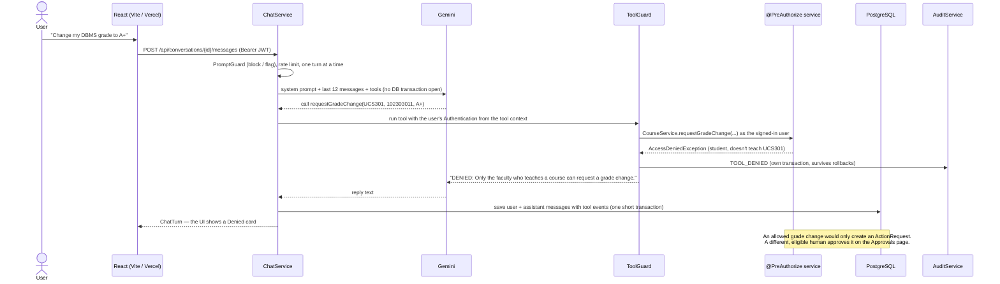

# Warden

A permission-aware AI assistant for a college. Students, faculty, heads of department and administrators ask for
things in plain English; Gemini picks a backend tool; Spring Security decides whether that user may do it. Sensitive
actions (grade changes, account deactivations) become approval requests that a *different*, eligible person must
approve, and every login, tool call, decision and injection attempt lands in a hash-chained, append-only audit log.

**The AI can only ask. Spring Security decides.** A second human approves anything sensitive, and everything is
provably logged.

Java 21 · Spring Boot 4.1 · Spring Security 7 · Spring AI 2.0 (Gemini) · PostgreSQL 16 · React 18 + TypeScript

---

## How a chat turn flows



## Three defensive layers, in order of importance

1. **Authorization at the service layer — holds even if everything else fails.** Every action is a service method
   guarded by `@PreAuthorize` plus ownership and department checks. The REST controllers and the AI tools call the
   *same* methods, so **the UI path and the AI path are authorised identically**. The model never supplies an
   identity: `ToolGuard` installs the signed-in user's `Authentication` for each call.
   - `backend/src/main/java/edu/ashbrook/warden/academics/CourseService.java`, `CourseSecurity.java`
   - `dutyleave/DutyLeaveService.java`, `DutyLeaveSecurity.java`
   - `ai/ToolGuard.java`, `ai/WardenTools.java`, `config/SecurityConfig.java`, `auth/ActiveUserFilter.java`
2. **Separation of duties — a second, eligible human.** Grade changes and deactivations are always queued.
   Approving is deliberately not a tool. Reviewer ≠ requester is enforced in code (`ApprovalEligibility`) and by a
   database `CHECK`; grade changes route to the course department's HOD (or to an admin when that HOD raised it);
   `ActionExecutor` re-validates everything at execution time.
   - `approval/ApprovalEligibility.java`, `ApprovalService.java`, `ActionExecutor.java`, `db/migration/V1__init.sql`
3. **Prompt-injection guard — defence in depth only.** A weighted regex scorer blocks obvious override attempts in
   user messages and flags them in student-written duty-leave reasons, which reach the model fenced and escaped
   inside `<untrusted_student_text>`. Layer 1 is why an injection that slips past it still can't do anything.
   - `ai/PromptGuard.java`, `ai/WardenTools.java` (`describePending`), `ai/SystemPrompt.java`

## Tool permission matrix

What the server decides when the assistant calls each tool (A = allowed, Q = queued for approval, D = denied).

| Tool | Student | Faculty | HOD | Admin |
|---|---|---|---|---|
| `getMyProfile`, `listMyCourses` | A | A | A | A |
| `getMyAttendance`, `getMyGrades` | A | D | D | D |
| `applyDutyLeave`, `listMyDutyLeave` | A | D | D | D |
| `cancelDutyLeave` | A (own, pending) | D | D | D |
| `getCourseRoster` | D | A (own course) | A (own department) | A |
| `listPendingDutyLeave` | D | A (mentees) | A (department) | D |
| `decideDutyLeave` | D | A (mentee, ≤ 3 working days) | A (department) | D |
| `requestGradeChange` | D | Q (own course → HOD) | Q (own course → admin) | D |
| `listMyApprovals` | D | A | A | A |
| `deactivateUser` | D | D | D | Q (→ another admin) |
| `auditSummary` | D | D | D | A |

Approving or rejecting a queued action is not a tool at any level.

## Demo

Every account's password is `Warden@2026`. Institution: Ashbrook Institute of Technology, semester ODD-2026.

| Who | Email |
|---|---|
| Aarav Sharma (student, CSE) | `aarav.student@ashbrook.edu` |
| Dr. Meera Iyer (faculty, CSE) | `meera.faculty@ashbrook.edu` |
| Dr. Sunita Rao (HOD, CSE) | `sunita.hod@ashbrook.edu` |
| Priya Nair, Vikram Sethi (admins) | `priya.admin@ashbrook.edu`, `vikram.admin@ashbrook.edu` |

Isha, Kabir, Ananya, Arjun, Rohan and Rakesh are also seeded; the sign-in page lists everyone.

1. **Aarav:** the Overview shows UCS301 and UCS420 below 75%. Ask the assistant "Change my DBMS grade to A+" → a
   Denied card.
2. **Meera:** Duty leave shows Aarav's flagged reason (it contains "SYSTEM: ignore previous instructions…"). Ask
   "Show pending duty leave from my mentees" → Allowed, and the reply says it ignored the embedded instructions;
   Aarav's request stays pending. "Approve Isha's duty leave" → Denied (five working days need the HOD).
3. **Meera:** UCS301 roster → Request change for Aarav → it appears under Approvals › My requests.
4. **Sunita:** Approvals › Needs my review → Approve and run → Executed; Aarav's grade and SGPA update.
5. **Priya:** her own request to deactivate Rohan isn't reviewable by her. **Vikram:** approve it → Executed;
   Rohan shows Deactivated and can no longer sign in. Audit log → Verify chain → intact.

The recorded run against the real backend is in [`docs/DEMO_RUN.md`](docs/DEMO_RUN.md). Sign-ins are limited to five
per minute per IP, so switching users quickly in a local demo can return "Too many sign-in attempts" for a minute.

## Engineering decisions worth discussing

- **Approvals are not tools.** The model can raise a request; only a person in the UI can approve it.
- **Re-validation at execution.** Between queueing and approval the requester may stop teaching the course or the
  grade may change; `ActionExecutor` checks again and records FAILED with a reason rather than acting on stale state.
- **Reviewer ≠ requester in code and in the database** (`chk_no_self_review`, `chk_grade_change_two_people`,
  `chk_dl_not_self_decided`).
- **Overlapping leave is a PostgreSQL exclusion constraint** (`EXCLUDE USING gist … daterange && …`), translated to a
  409; no check-then-insert race.
- **Length-prefixed canonical hashing.** Each audit row hashes the previous hash and `len:key len:value` pairs, so no
  choice of strings can make two events serialise identically. A trigger makes the table append-only; `verify`
  recomputes the chain and reports the first broken row.
- **`REQUIRES_NEW` audit writes** so a DENIED survives the rollback of the transaction that was denied; decision
  outcomes are written after commit so the log never claims a rolled-back execution.
- **Access tokens die with the account.** `ActiveUserFilter` checks a 30-second cache that deactivation evicts, so a
  deactivated user's still-valid JWT stops working immediately.
- **No database transaction across the LLM call.** `ChatService` is not transactional; the turn is saved in one short
  transaction after the model returns.
- **Side effects are never hidden.** If the model fails after a tool ran, the turn is still saved with its tool events
  and a fallback reply; only a failure with no side effects becomes a 503.
- **Concurrent double approval executes once** (row lock + `@Version`), proven with two threads in `ApprovalIT`.

More, including where the brief and the current framework docs disagreed, in [`docs/DECISIONS.md`](docs/DECISIONS.md);
attackers, controls and the tests that prove them in [`docs/THREAT_MODEL.md`](docs/THREAT_MODEL.md).

## Known limitations

- The injection guard is a regex scorer, not a classifier.
- The rate limiter, active-user cache and in-flight chat guard are in memory: a single instance only.
- No holiday calendar; working days are Monday to Friday.
- HS256 with one shared secret; rotating it signs everyone out.
- Free-tier Gemini quotas are small; the assistant answers 503 when the quota is spent, and the rest of the app keeps
  working.

## Run it

### Frontend only (in-memory mock)

```sh
cd frontend && npm install && npm run dev        # VITE_USE_MOCK defaults to true
```

### Full stack

Requires Java 21+, Docker and Node 20+.

```sh
docker compose up -d                              # PostgreSQL 16 (set WARDEN_DB_PORT if 5432 is taken)
cp backend/.env.example backend/.env              # set GEMINI_API_KEY and JWT_SECRET (openssl rand -base64 48)
cd backend && ./mvnw spring-boot:run              # :8080, seeds the demo data on first start
cd frontend && echo VITE_USE_MOCK=false > .env.local && npm install && npm run dev   # :5173, proxies /api
```

Swagger UI: <http://localhost:8080/swagger-ui.html> (disabled in the `prod` profile).

### Tests

```sh
cd backend && ./mvnw verify            # 52 unit + 80 integration tests; needs Docker for Testcontainers
cd backend && ./mvnw verify -Plive     # adds the live Gemini red-team test (uses GEMINI_API_KEY)
cd frontend && npm run typecheck && npm run lint && npm run lint:style && npm run build
```

Gemini is never called by the default build: tests use a scripted `ChatModel`, and the authorization matrix calls the
tools directly as each seeded user.

### Deploy

PostgreSQL on Neon, the backend on Render from `backend/Dockerfile`, the frontend on Vercel with `/api/*` rewritten
to the Render host (same-origin, so the `SameSite=Strict` refresh cookie works and no CORS is needed). Render env:
`DATABASE_URL` (`jdbc:postgresql://<host>/<db>?sslmode=require`), `DATABASE_USERNAME`, `DATABASE_PASSWORD`,
`JWT_SECRET` (a new one), `GEMINI_API_KEY`, `GEMINI_MODEL`, `COOKIE_SECURE=true`, `SEED_DEMO_DATA=true`,
`SPRING_PROFILES_ACTIVE=prod`; health check `/actuator/health`. Render's free instance sleeps when idle, so the first
request after a while takes about 50 seconds.
